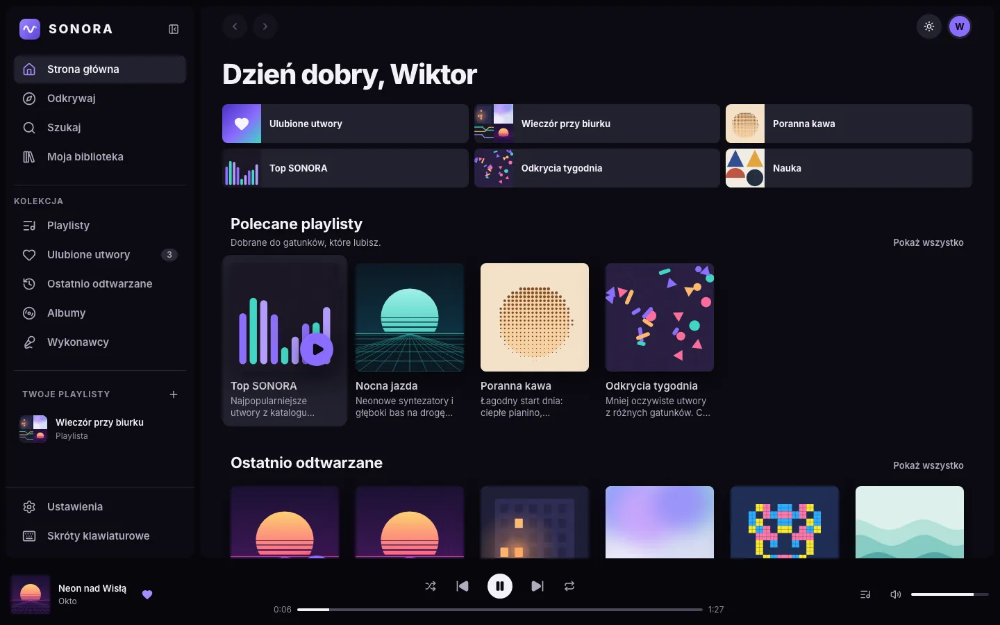
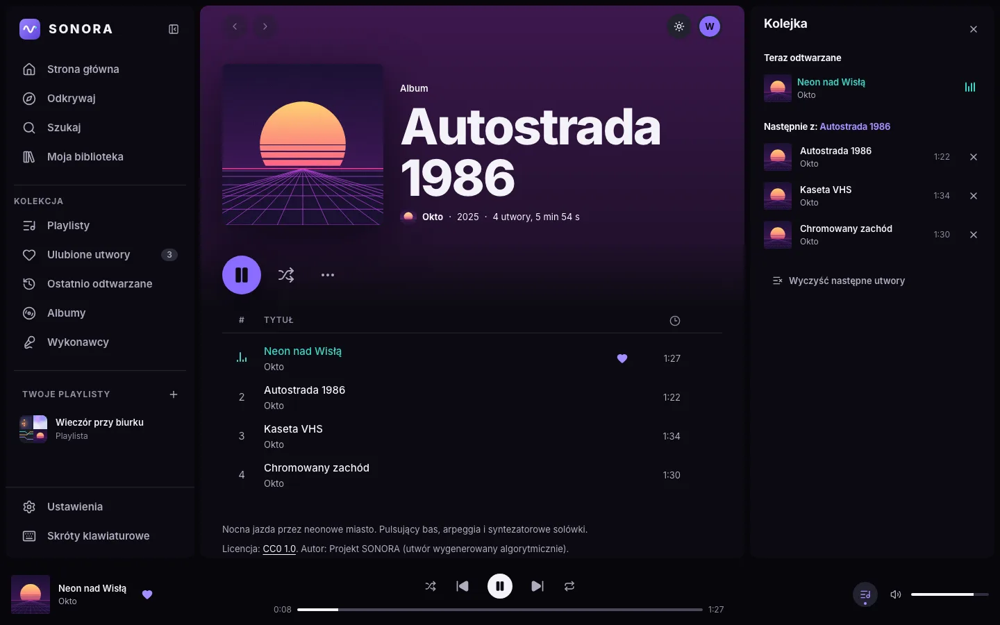
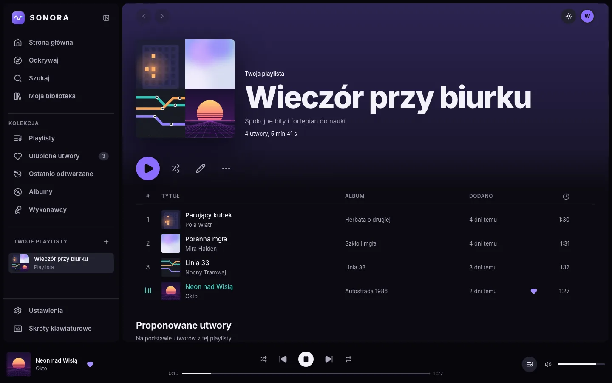
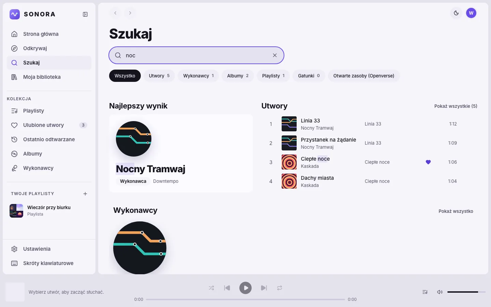
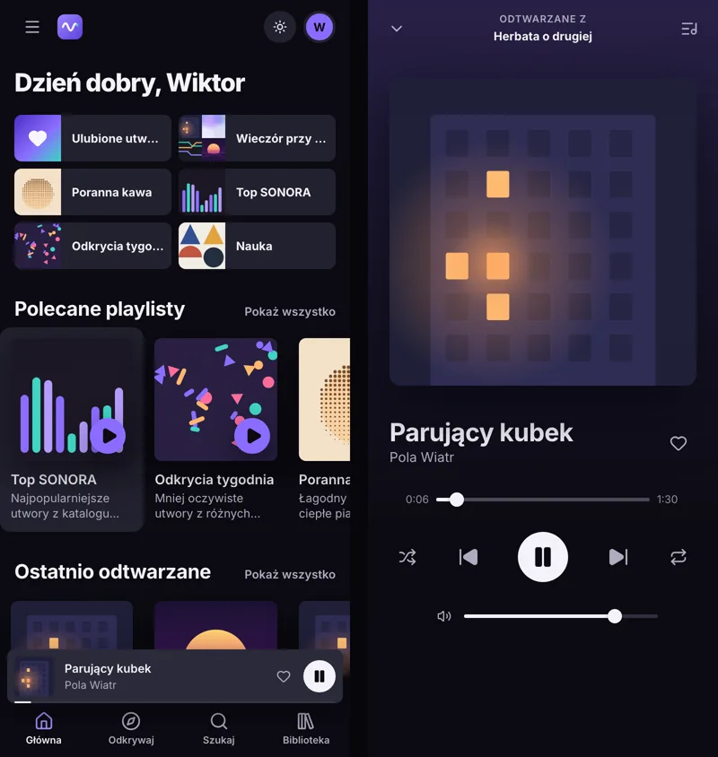

# SONORA

Aplikacja muzyczna w przeglądarce inspirowana profesjonalnymi serwisami streamingowymi. Napisana w React, TypeScript i Vite. Działa bez konta i bez serwera: playlisty, ulubione utwory, historia i ustawienia zapisują się w pamięci przeglądarki.

SONORA to projekt edukacyjny. Nie jest powiązana z żadnym komercyjnym serwisem muzycznym i nie korzysta z jego logo ani materiałów.



| Album i kolejka odtwarzania                                          | Własna playlista                                               |
| -------------------------------------------------------------------- | -------------------------------------------------------------- |
|  |  |

| Wyszukiwarka w jasnym motywie                                        | Telefon: strona główna i odtwarzacz             |
| -------------------------------------------------------------------- | ----------------------------------------------- |
|  |  |

## Spis treści

- [Funkcje](#funkcje)
- [Technologie](#technologie)
- [Instalacja i uruchomienie](#instalacja-i-uruchomienie)
- [Skrypty](#skrypty)
- [Struktura projektu](#struktura-projektu)
- [Architektura](#architektura)
- [Muzyka demonstracyjna i źródła audio](#muzyka-demonstracyjna-i-źródła-audio)
- [Opcjonalne usługi i zmienne środowiskowe](#opcjonalne-usługi-i-zmienne-środowiskowe)
- [Testy](#testy)
- [Dostępność i responsywność](#dostępność-i-responsywność)
- [Znane ograniczenia](#znane-ograniczenia)
- [Pomysły na rozwój](#pomysły-na-rozwój)
- [Publikacja na GitHubie](#publikacja-na-githubie)
- [Licencje i źródła materiałów](#licencje-i-źródła-materiałów)

## Funkcje

**Odtwarzacz**

- Odtwarzanie przez HTML5 Audio API; jeden element audio w całej aplikacji, więc nigdy nie grają dwa utwory naraz (także w kilku kartach przeglądarki).
- Odtwórz i pauza, poprzedni i następny utwór, automatyczne przejście do kolejnego utworu.
- Pasek postępu z przewijaniem, aktualny i całkowity czas, informacja o pobranej części utworu.
- Głośność i wyciszanie (zapamiętywane), tryb losowy, powtarzanie kolejki lub jednego utworu.
- Autoodtwarzanie: po skończeniu kolejki aplikacja gra podobne utwory (można wyłączyć).
- Kolejka: bieżący utwór, „Następne w kolejce” (dodane ręcznie), dalsza część listy, przechodzenie do wybranego utworu, usuwanie pozycji, czyszczenie.
- Obsługa błędów: niedostępne źródło, brak internetu, blokada autoodtwarzania przez przeglądarkę. Aplikacja pokazuje czytelny komunikat z przyciskiem „Spróbuj ponownie” i nie udaje, że muzyka gra.
- Klawisze multimedialne i ekran blokady telefonu (Media Session API).
- Po odświeżeniu strony wraca kolejka i miejsce w utworze (bez automatycznego grania).

**Muzyka**

- Strona główna: powitanie zależne od pory dnia, szybki dostęp, polecane playlisty, ostatnio odtwarzane, ranking popularnych utworów, nowe wydania, gatunki, polecane albumy, playlisty do nauki, pracy, treningu i relaksu, nastroje, popularni wykonawcy i sekcja „Odkryj coś nowego”.
- Widoki albumu, wykonawcy, gatunku i playlisty; biblioteka z filtrami, wyszukiwaniem i sortowaniem.
- Wyszukiwarka: wyniki podczas pisania, filtrowanie (utwory, wykonawcy, albumy, playlisty, gatunki), podświetlanie dopasowań, ignorowanie polskich znaków („swiatlo” znajdzie „Światło”), ostatnie wyszukiwania, obsługa klawiatury (Enter, Escape).
- Opcjonalne wyszukiwanie w Openverse, otwartym katalogu utworów na licencjach Creative Commons, z opóźnieniem zapytań (debounce), szkieletem ładowania i obsługą błędów.

**Playlisty i ulubione**

- Tworzenie, edycja nazwy i opisu, dodawanie i usuwanie utworów (z możliwością cofnięcia), usuwanie całej playlisty po potwierdzeniu.
- Liczba utworów i łączny czas, odtwarzanie całości i losowe, propozycje utworów do dodania.
- Okładka playlisty tworzona automatycznie z okładek utworów.
- Udostępnianie: link zawiera dane playlisty, więc otworzy się na innym komputerze; odbiorca może zapisać kopię.
- Ulubione utwory z sortowaniem (data dodania, tytuł, wykonawca). Stan serca jest spójny w całej aplikacji.
- Historia ostatnio odtwarzanych, pogrupowana po dniach.

**Interfejs**

- Ciemny i jasny motyw (oraz „systemowy”), zapamiętywany wybór.
- Panel boczny: pełny, zwinięty do ikon albo wysuwany na mniejszych ekranach.
- Na telefonach: dolne menu, mini odtwarzacz i pełnoekranowy widok odtwarzania.
- Menu kontekstowe utworu (przycisk „…” oraz prawy przycisk myszy).
- Powiadomienia, okna potwierdzenia, podpowiedzi przy przyciskach z ikonami.
- Szkielety ładowania, dopracowane puste stany i strony błędów (w tym 404).
- Ekran powitalny dla nowych użytkowników (imię i ulubione gatunki).
- Skróty klawiaturowe (lista w aplikacji pod klawiszem `?`).
- Ustawienia: profil, motyw, ograniczenie animacji, autoodtwarzanie, pamiętanie kolejki, Openverse, czyszczenie danych.

## Technologie

| Obszar                          | Narzędzie                                                    |
| ------------------------------- | ------------------------------------------------------------ |
| Interfejs                       | React 19, TypeScript 6 (tryb ścisły)                         |
| Budowanie i serwer deweloperski | Vite 8                                                       |
| Nawigacja                       | React Router 7 (routing oparty na `#`)                       |
| Ikony                           | Lucide React                                                 |
| Krój pisma                      | Inter (`@fontsource-variable/inter`, hostowany lokalnie)     |
| Style                           | CSS Modules i zmienne CSS (tokeny w `src/styles/tokens.css`) |
| Stan                            | React Context, `useReducer` i własne hooki                   |
| Testy                           | Vitest, React Testing Library, jsdom                         |
| Jakość kodu                     | ESLint 10 (typescript-eslint, reguły hooków), Prettier       |

Wymagany jest **Node.js 22.13 lub nowszy** (najlepiej aktualna wersja LTS). Plik `.nvmrc` zawiera wersję 22.

## Instalacja i uruchomienie

```bash
git clone https://github.com/cryvult/spotify.git sonora
cd sonora
npm install
npm run dev
```

Aplikacja uruchomi się pod adresem pokazanym w terminalu (zwykle `http://localhost:5173`).

Wersja produkcyjna:

```bash
npm run build     # wynik w folderze dist/
npm run preview   # podgląd zbudowanej wersji
```

Zbudowana aplikacja to zwykłe pliki statyczne. Używa ścieżek względnych i routingu z `#`, więc działa także z podkatalogu (np. GitHub Pages) i po odświeżeniu dowolnego widoku.

## Skrypty

| Polecenie                         | Opis                                                           |
| --------------------------------- | -------------------------------------------------------------- |
| `npm run dev`                     | serwer deweloperski z odświeżaniem na żywo                     |
| `npm run build`                   | sprawdzenie typów i budowanie wersji produkcyjnej              |
| `npm run preview`                 | podgląd wersji produkcyjnej                                    |
| `npm run lint`                    | ESLint dla całego projektu                                     |
| `npm run typecheck`               | sprawdzenie typów TypeScript                                   |
| `npm run test`                    | wszystkie testy (jednorazowo)                                  |
| `npm run test:watch`              | testy w trybie obserwowania zmian                              |
| `npm run format` / `format:check` | formatowanie kodu Prettierem / sprawdzenie formatowania        |
| `npm run generate:audio`          | ponowne wygenerowanie utworów demonstracyjnych (wymaga ffmpeg) |
| `npm run generate:covers`         | ponowne wygenerowanie okładek SVG                              |

## Struktura projektu

```
sonora/
├── public/
│   ├── audio/                 # 20 wygenerowanych utworów MP3
│   ├── covers/                # okładki SVG albumów, playlist i wykonawców
│   └── favicon.svg
├── scripts/
│   ├── generate-audio.mjs     # generator muzyki (syntezator napisany w JavaScripcie)
│   ├── generate-covers.mjs    # generator okładek
│   └── audio/                 # DSP, instrumenty, teoria muzyki, aranżacje gatunków
├── src/
│   ├── app/                   # App, router, kolejność providerów
│   ├── components/
│   │   ├── layout/            # AppLayout, Sidebar, TopBar, MobileNavigation, NavDrawer
│   │   ├── player/            # MusicPlayer, PlayerControls, ProgressBar, VolumeControl, QueuePanel, MiniPlayer, NowPlayingSheet
│   │   ├── music/             # TrackRow, TrackList, karty, okładki, nagłówki kolekcji, półki
│   │   └── ui/                # Button, IconButton, Modal, Menu, Tooltip, Toaster, Skeleton, Slider, Switch...
│   ├── context/               # konteksty i providery: ustawienia, biblioteka, odtwarzacz, powiadomienia, interfejs, okna
│   ├── data/                  # dane demonstracyjne (utwory, albumy, wykonawcy, playlisty, gatunki) i katalog
│   ├── features/              # widoki i logika funkcji: home, search, library, playlists, player, settings...
│   ├── hooks/                 # useKeyboardShortcuts, useTrackActions, useCollectionPlayback, useMediaQuery...
│   ├── services/              # audioEngine, storageService, openverseService
│   ├── styles/                # tokens.css (zmienne), global.css
│   ├── test/                  # konfiguracja testów, atrapa elementu audio, renderowanie aplikacji
│   ├── types/                 # typy: utwory, albumy, playlisty, stan odtwarzacza
│   ├── utils/                 # formatowanie czasu, odmiana liczebników, tasowanie, normalizacja tekstu...
│   └── main.tsx
├── docs/screenshots/          # zrzuty ekranu do README
├── .github/workflows/         # CI i opcjonalna publikacja na GitHub Pages
└── index.html
```

Testy leżą obok testowanego kodu (`*.test.ts`, `*.test.tsx`).

## Architektura

**Odtwarzanie dźwięku** składa się z trzech warstw:

1. `src/features/player/playerReducer.ts` to czysta funkcja opisująca kolejkę i tryby (następny, poprzedni, losowo, powtarzanie, dodawanie do kolejki). Nie dotyka dźwięku, więc łatwo ją przetestować.
2. `src/services/audioEngine.ts` opakowuje jeden element `<audio>`: wczytuje pliki, odtwarza, przewija, rozpoznaje blokadę autoodtwarzania i tłumaczy błędy na czytelne komunikaty. Nasłuchiwacze zdarzeń są podłączane w `attach()` i usuwane w `detach()`.
3. `src/context/PlayerProvider.tsx` łączy oba elementy: obserwuje stan i steruje silnikiem, zapisuje historię, obsługuje Media Session API i synchronizację kart (BroadcastChannel).

Postęp odtwarzania jest udostępniany przez `useSyncExternalStore` w osobnym hooku `usePlaybackProgress`. Dzięki temu kilka razy na sekundę odświeża się tylko pasek postępu, a nie cała aplikacja. Stan odtwarzacza i jego akcje są w dwóch kontekstach, więc komponenty używające tylko akcji nie renderują się ponownie.

**Biblioteka użytkownika** (`src/features/library/libraryReducer.ts`) przechowuje playlisty, ulubione, historię i ostatnie wyszukiwania. Odczyt z pamięci przechodzi przez funkcję `parseLibrary`, która pomija uszkodzone wpisy zamiast kasować całe dane.

**Zapisywanie danych** (`src/services/storageService.ts`) to jedyne miejsce, które korzysta z `localStorage`. Obsługuje brak danych, uszkodzony JSON, dane w złym formacie, brak miejsca i niedostępną pamięć (np. tryb prywatny). Klucze mają prefiks `sonora:v1:`. Aplikacja nie przechowuje haseł ani danych poufnych.

**Dane katalogu** są w osobnych plikach TypeScript w `src/data`. Utwory zawierają tylko identyfikatory albumu i wykonawcy; nazwy i okładki są dołączane w `catalog.ts`, więc nic się nie powiela.

**Widoki** ładują się na żądanie (`React.lazy`). Podczas pobierania widoku wyświetla się szkielet strony. Błędy renderowania łapie `ErrorBoundary`, więc awaria jednego widoku nie zatrzymuje muzyki ani nawigacji.

**Style** to CSS Modules korzystające ze wspólnych zmiennych (kolory, odstępy, typografia, cienie, zaokrąglenia, warstwy) z `src/styles/tokens.css`. Motyw jasny podmienia wartości zmiennych.

## Muzyka demonstracyjna i źródła audio

Katalog zawiera **26 utworów** w 8 wydaniach:

- **20 utworów wygenerowanych algorytmicznie** przez skrypt `scripts/generate-audio.mjs`: własny syntezator w JavaScripcie (oscylatory, filtry, pianino FM, struna Karplusa-Stronga, perkusja, pogłos, limiter i normalizacja głośności według EBU R128). Pliki MP3 są w `public/audio`, więc grają zawsze, także bez internetu. Wykonawcy tych utworów (Pola Wiatr, Okto, Mira Halden, Kaskada, Bit Brigada, Nocny Tramwaj) są **fikcyjni** i aplikacja wyraźnie to zaznacza.
- **6 utworów Kevina MacLeoda** (incompetech.com) na licencji CC BY 3.0, odtwarzanych bezpośrednio z Wikimedia Commons. Wymagają internetu. Gdy źródło jest niedostępne, aplikacja pokazuje komunikat z informacją, że utwór pochodzi z zewnętrznego źródła, i pozwala go pominąć.

Ponowne wygenerowanie muzyki: `npm run generate:audio` (potrzebny program `ffmpeg`). Generator jest deterministyczny, więc daje te same utwory. Wybrane utwory: `npm run generate:audio -- szklo pulsar`.

Okładki to abstrakcyjne grafiki SVG z `scripts/generate-covers.mjs`. Okładki utworów Kevina MacLeoda są grafikami zastępczymi SONORA, a nie oryginalnymi okładkami.

## Opcjonalne usługi i zmienne środowiskowe

Aplikacja **nie wymaga kluczy API ani sekretów**. Jedyną zewnętrzną usługą jest Openverse (wyszukiwanie utworów na licencjach Creative Commons). Działa bez klucza, ale ma limit zapytań dla użytkowników anonimowych (około 20 na minutę i 200 na dzień z jednego adresu IP), dlatego wyszukiwarka wysyła zapytanie dopiero po przerwie w pisaniu i zapamiętuje wyniki.

Usługę można wyłączyć:

- dla siebie: Ustawienia → „Wyszukiwanie w Openverse”,
- dla całej zbudowanej aplikacji: skopiuj `.env.example` jako `.env` i ustaw `VITE_ENABLE_OPENVERSE=false`, a następnie zbuduj aplikację ponownie.

## Testy

```bash
npm run test
```

Projekt ma 121 testów w 18 plikach:

- jednostkowe: formatowanie czasu i odmiana liczebników, tasowanie, normalizacja tekstu, wyszukiwarka, reducer odtwarzacza (kolejka, tryby, błędy), reducer biblioteki, zapisywanie danych (uszkodzone i nieprawidłowe zapisy, brak miejsca), udostępnianie playlist, przywracanie stanu odtwarzacza, silnik audio, usługa Openverse, spójność danych katalogu;
- integracyjne (cała aplikacja w jsdom z atrapą elementu audio): nawigacja, ekran powitalny, odtwarzanie, postęp, pauza, następny utwór, koniec utworu, głośność, tryby, błąd z ponowieniem, blokada autoodtwarzania, historia, wyszukiwarka, tworzenie, edycja i usuwanie playlist, menu kontekstowe, ulubione z cofaniem i sortowaniem, kolejka.

## Dostępność i responsywność

- Semantyczny HTML (nawigacja, `main`, sekcje z nagłówkami, listy), etykiety dla wszystkich przycisków z ikonami.
- Widoczny pierścień fokusu przy obsłudze klawiaturą, link „Przejdź do treści”, przenoszenie fokusu po zmianie widoku.
- Okna dialogowe na natywnym elemencie `<dialog>` (pułapka fokusu, Escape, powrót fokusu).
- Suwaki oparte na `<input type="range">` z opisem wartości dla czytników ekranu („1 min 5 s z 3 min 20 s”).
- Region `aria-live` dla powiadomień, komunikaty błędów z `role="alert"`.
- Kontrast tekstu zgodny z WCAG AA w obu motywach.
- Respektowanie systemowego ustawienia ograniczenia animacji oraz własne ustawienie w aplikacji.
- Układ dla telefonów, tabletów i komputerów; duże pola dotyku, obsługa bezpiecznych obszarów ekranu (`env(safe-area-inset-*)`), brak poziomego przewijania strony.
- Leniwe ładowanie obrazów z wymiarami (bez przeskakiwania układu).

## Znane ograniczenia

- Dane są zapisywane tylko w tej przeglądarce. Nie ma kont ani synchronizacji między urządzeniami; wyczyszczenie danych przeglądarki usuwa playlisty.
- Wygenerowane utwory trwają ok. 1-1,5 minuty i mają charakter demonstracyjny.
- Utwory z Wikimedia Commons i Openverse wymagają internetu, a ich dostępność zależy od zewnętrznych serwisów.
- Wyniki z Openverse mają różne licencje (także z ograniczeniem do użytku niekomercyjnego). Szczegóły są w menu utworu, w pozycji „Źródło i licencja”.
- Link do playlisty zawiera tylko utwory z katalogu SONORA (utwory z Openverse są pomijane i aplikacja o tym informuje).
- iOS nie pozwala stronom zmieniać głośności; na iPhonie zamiast suwaka pojawia się podpowiedź o przyciskach głośności.
- Przeglądarki mogą blokować automatyczne odtwarzanie; wtedy pojawia się przycisk „Odtwórz”.

## Pomysły na rozwój

- Prawdziwe konta i synchronizacja przez backend (np. Node.js z bazą danych).
- Eksport i import biblioteki do pliku JSON.
- Zmiana kolejności utworów na playliście przeciąganiem.
- Teksty piosenek, wizualizacja dźwięku (Web Audio API), korektor graficzny.
- Płynne przejścia między utworami (crossfade).
- Aplikacja instalowalna (PWA) z pamięcią podręczną utworów do słuchania offline.
- Testy end-to-end w prawdziwej przeglądarce (Playwright).

## Publikacja na GitHubie

Repozytorium jest przygotowane: ma `.gitignore` (bez `node_modules`, `dist` i plików `.env`), konfigurację CI oraz opcjonalną publikację na GitHub Pages.

### 1. Utwórz repozytorium na GitHubie

Zaloguj się na konto, na którym ma być projekt, wejdź na https://github.com/new i utwórz **puste** repozytorium (bez README, .gitignore i licencji, bo są już w projekcie), np. `spotify`.

### 2. Sprawdź konfigurację Gita (jednorazowo)

```bash
git config --global user.name    # jeśli puste: git config --global user.name "Imię Nazwisko"
git config --global user.email   # jeśli puste: git config --global user.email "adres@example.com"
```

### 3. Zatwierdź kod i wyślij go

Jeśli folder nie jest jeszcze repozytorium Gita:

```bash
cd sonora
git init -b main
git add .
git commit -m "SONORA: aplikacja muzyczna w React i TypeScript"
git remote add origin https://github.com/cryvult/spotify.git
git push -u origin main
```

Jeśli repozytorium już istnieje i ma commity, wystarczy:

```bash
git add .
git commit -m "Opis zmian"
git push
```

Przy pierwszym `git push` GitHub poprosi o zalogowanie. Najprościej użyć GitHub CLI (`gh auth login`) albo tokenu dostępu zamiast hasła.

### 4. (Opcjonalnie) GitHub Pages

1. Settings → Pages → Build and deployment → Source: **GitHub Actions**.
2. Actions → „Publikacja na GitHub Pages” → **Run workflow**.
3. Po kilku minutach aplikacja będzie pod adresem `https://<użytkownik>.github.io/<repozytorium>/`.
4. Aby publikować automatycznie po każdym `git push`, dodaj w Settings → Secrets and variables → Actions → Variables zmienną `DEPLOY_PAGES` z wartością `true`.

Workflow CI (`.github/workflows/ci.yml`) przy każdym wysłaniu kodu uruchamia lint, sprawdzanie typów, testy i budowanie.

## Licencje i źródła materiałów

- **Kod aplikacji**: licencja MIT (plik `LICENSE`).
- **Wygenerowane utwory** w `public/audio`: utworzone skryptem projektu, udostępnione na licencji [CC0 1.0](https://creativecommons.org/publicdomain/zero/1.0/deed.pl).
- **Utwory Kevina MacLeoda** (incompetech.com), licencja [CC BY 3.0](https://creativecommons.org/licenses/by/3.0/deed.pl), pliki z Wikimedia Commons:
  [Carefree](https://commons.wikimedia.org/wiki/File:Kevin_MacLeod_-_Carefree.ogg),
  [Dream Culture](https://commons.wikimedia.org/wiki/File:Kevin_MacLeod_-_Dream_Culture.ogg),
  [Smoother Move](https://commons.wikimedia.org/wiki/File:Kevin_MacLeod_-_Smoother_Move.ogg),
  [Silver Blue Light](https://commons.wikimedia.org/wiki/File:Kevin_MacLeod_-_Silver_Blue_Light.ogg),
  [Sovereign Quarter](https://commons.wikimedia.org/wiki/File:Kevin_MacLeod_-_Sovereign_Quarter.ogg),
  [Cattails](https://commons.wikimedia.org/wiki/File:Kevin_MacLeod_-_Cattails.mp3).
- **Okładki i logo**: grafiki SVG wygenerowane skryptem projektu.
- **Ikony**: [Lucide](https://lucide.dev), licencja ISC.
- **Krój pisma**: [Inter](https://rsms.me/inter/), SIL Open Font License 1.1.
- **Openverse**: wyniki wyszukiwania pochodzą z [Openverse](https://openverse.org); każdy utwór ma własną licencję podaną w aplikacji.
